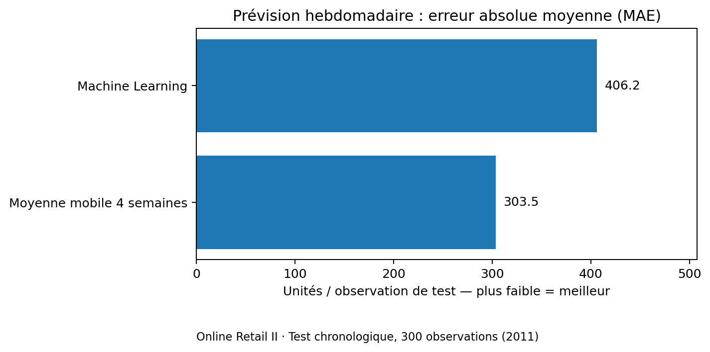
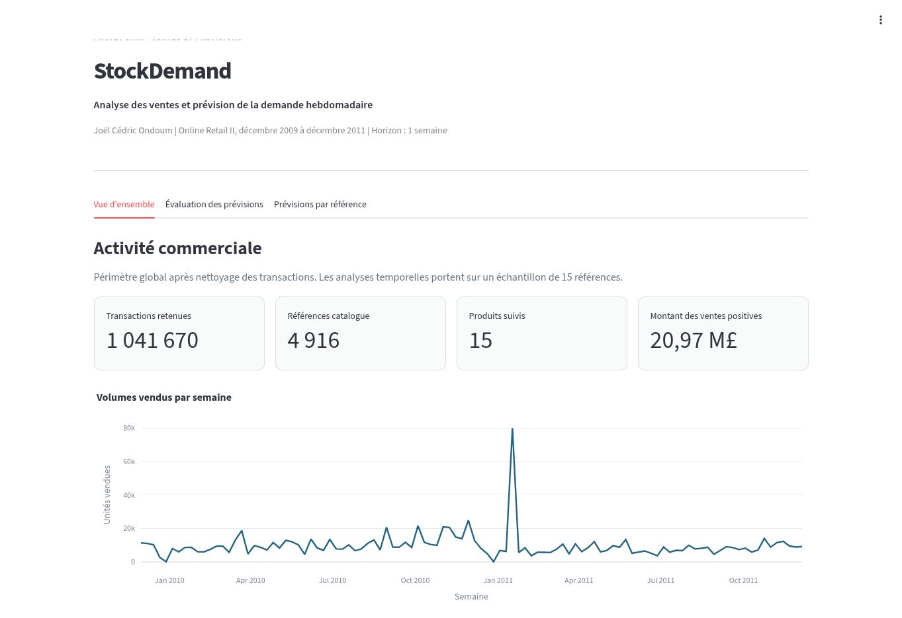
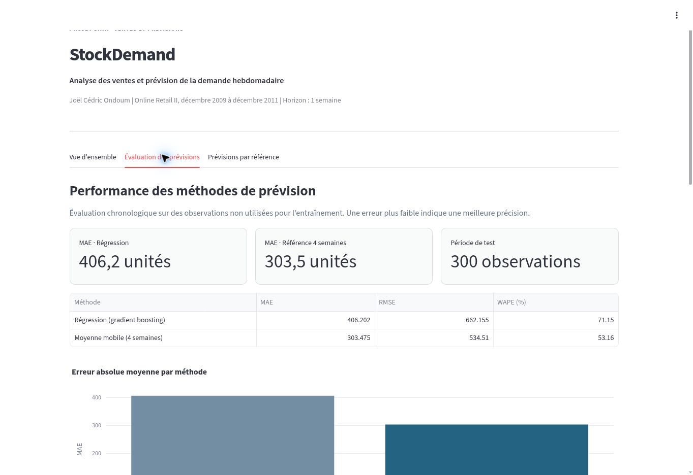
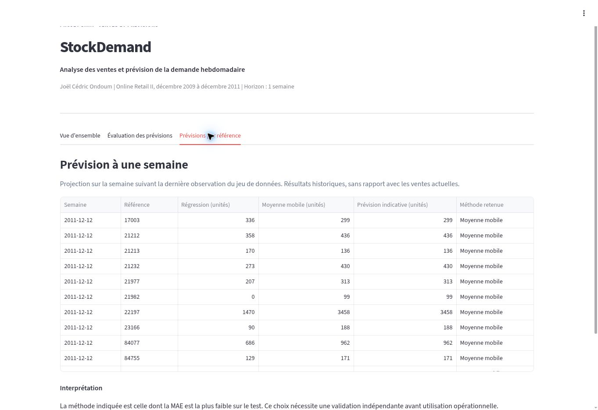

# StockDemand

**Analyse des ventes et prévision de la demande commerciale**  
*Projet personnel — Joël Cédric Ondoum | MBA Data & Intelligence Artificielle, MyDigitalSchool Angers*

[**Consulter la démonstration interactive**](https://stockdemand-joel-ondoum.mighty-mule-5001.chatgpt.site)

La démonstration reprend les résultats du tableau de bord Streamlit dans une interface web. Elle permet de parcourir les trois sections et de comparer les prévisions par référence produit.

## Présentation

StockDemand est un projet d’analyse de transactions commerciales et de prévision hebdomadaire des quantités vendues. Il couvre la préparation des données, la constitution d’un historique par produit, les indicateurs métier et la comparaison de deux approches de prévision.

Le projet a été développé sur le jeu de données public **Online Retail II**, publié par UCI Machine Learning Repository. Les données couvrent décembre 2009 à décembre 2011.

## Vue synthétique

| Périmètre | Résultat |
|---|---:|
| Transactions initiales | 1 067 371 |
| Transactions retenues après nettoyage | 1 041 670 |
| Transactions exclues | 25 701 |
| Références distinctes du catalogue | 4 916 |
| Ventes positives analysées | 20,97 M£ |
| Références sélectionnées pour la prévision | 15 |
| Semaines dans le panel de prévision | 106 |

Le montant présenté correspond aux **ventes positives**, hors retours et annulations, et non aux ventes nettes.

## Travail réalisé

- Importation et contrôle qualité des données commerciales avec Python et Pandas.
- Normalisation des champs, filtrage des lignes invalides et agrégation hebdomadaire.
- Structuration d’un panel produit/semaine et export dans SQLite pour l’analyse SQL.
- Construction de variables historiques : retards de ventes, moyennes mobiles et saisonnalité.
- Entraînement d’un modèle de régression par gradient boosting (Scikit-learn).
- Comparaison avec une prévision de référence basée sur les quatre semaines précédentes.
- Réalisation d’un tableau de bord Streamlit avec KPI, tendances commerciales et prévisions par article.

**Technologies :** Python, Pandas, NumPy, SQL, SQLite, Scikit-learn, Streamlit, Plotly, Pytest.

## Résultats de l’évaluation

Test chronologique : **25 juillet au 5 décembre 2011**, sur **300 observations**.

| Indicateur | Régression (gradient boosting) | Moyenne mobile 4 semaines |
|---|---:|---:|
| MAE (unités) | 406,20 | **303,48** |
| RMSE (unités) | 662,16 | **534,51** |
| WAPE | 71,15 % | **53,16 %** |

La moyenne mobile de quatre semaines obtient une erreur plus faible sur cette période. Ces résultats montrent l’intérêt de comparer le modèle à une méthode simple. Le choix final doit être confirmé sur un jeu de test indépendant.

## Tableau de bord

Le tableau de bord Streamlit comporte trois sections. Les captures ci-dessous proviennent de l’application exécutée avec les résultats du projet.

### Vue d’ensemble

Indicateurs commerciaux, tendances hebdomadaires et références les plus vendues du panel.

### Évaluation des prévisions

Comparaison des méthodes, erreurs par référence et évolution des ventes observées et estimées.

### Prévisions par référence

Volumes estimés pour la semaine du 12 décembre 2011, après la dernière observation du jeu de données.

[Parcourir la démonstration interactive](https://stockdemand-joel-ondoum.mighty-mule-5001.chatgpt.site)

La démonstration web est une adaptation du dashboard Streamlit : elle utilise les mêmes résultats calculés et permet de changer de référence produit. Elle ne réentraîne pas les modèles en ligne.

## Cadre et limites

- Le jeu de données s’achève en décembre 2011 : les prévisions ne concernent pas 2026.
- Le périmètre modélisé comprend 15 références sélectionnées, et non l’ensemble du catalogue.
- Les informations sur les stocks et fournisseurs sont absentes. Ce projet prévoit des ventes, pas des ruptures de stock.
- Les données et résultats sont issus d’un exercice d’analyse sur données publiques, et non d’une mission en entreprise.
- La méthode affichée est choisie selon sa MAE sur le test. Une validation indépendante reste nécessaire avant une utilisation opérationnelle.

## Accès au projet

Ce dépôt est une **présentation publique**. Il contient la documentation et les visuels du projet. Le code source de l’application, les fichiers de données et les modèles ne sont pas publiés dans ce dépôt.

## Source des données

Chen, D. (2012). *Online Retail II*. UCI Machine Learning Repository. [DOI : 10.24432/C5CG6D](https://doi.org/10.24432/C5CG6D) — licence CC BY 4.0.
